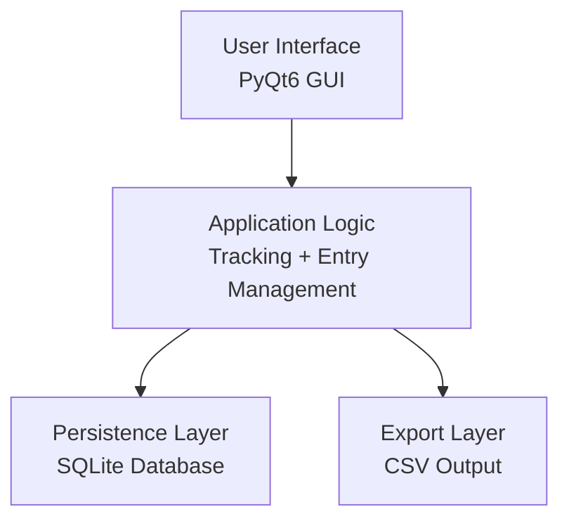
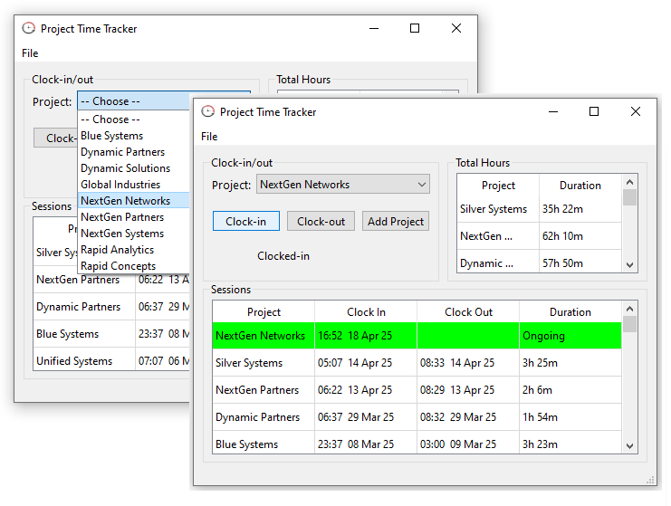
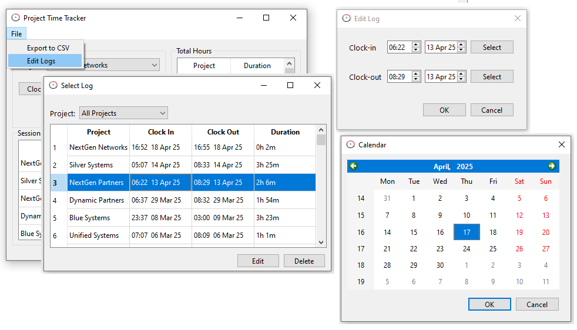

# Project Time Tracker

A lightweight desktop time-tracking application built with Python, PyQt6, and SQLite.

The application provides a simple way to track project-based work sessions, manage logged entries, and export time data for later review or reporting.

This project focuses on desktop application development, local persistence, modular architecture, and separation of UI logic from core business logic.

---

## 🎯 Engineering Focus

This project was built to demonstrate:

- Desktop GUI development with PyQt6
- Separation of UI and application logic
- Local persistence using SQLite
- Project-based time tracking workflows
- CRUD operations for time entries
- CSV export of tracked data
- Modular Python application structure
- Practical tooling for productivity workflows

---

## 🛠️ Tech Stack

- **Language:** Python
- **GUI:** PyQt6
- **Database:** SQLite
- **Data Export:** CSV
- **Architecture:** Modular desktop application
- **Development:** Git

---

## 🔑 Key Features

- Clock in / clock out time tracking
- Project-based organisation
- Manual entry editing
- Entry deletion
- Local SQLite storage
- CSV export
- Lightweight desktop interface
- CLI and GUI entry points

---

## 📈 Application Architecture



The application separates user interaction, tracking logic, persistence, and export behaviour into distinct areas to improve maintainability.

---

## 🖼️ Screenshots

Here are some screenshots of the application in action:

### Clock In / Clock Out Interface

  

### Edit / Delete Logs

  

---

## ⚙️ Running Locally
```bash
# Clone the repository:
git clone https://github.com/xMattC/Project-time-tracker.git

# Change dir:
cd Project-time-tracker

# Create a virtual environment:
python -m venv .venv

# Activate the environment:
.venv\Scripts\activate # Windows

source .venv/bin/activate # Linux / macOS

# Install dependencies:
pip install -r requirements.txt

#Run the GUI application:
python tracker_gui.py

#Optional CLI entry point:
python tracker_cli.py
```

---

## 💾 Data Storage

All data is stored locally using SQLite.

No external services are required.

---

## ⚠️ Current Limitations

- Designed as a lightweight local desktop tool
- No multi-user authentication
- No cloud synchronisation
- Limited automated test coverage
- Packaging/distribution is not currently implemented

---

## 🚀 Planned Improvements

- Improved validation for time entries
- Enhanced CSV export formatting
- Unit tests for core tracking logic
- Application packaging for easier distribution
- Additional reporting views

---

## 🧠 Software Engineering Skills Demonstrated

This project demonstrates:

- Python desktop application development
- GUI design with PyQt6
- SQLite persistence
- CRUD workflow implementation
- Modular application structure
- Local data export
- Separation of concerns
